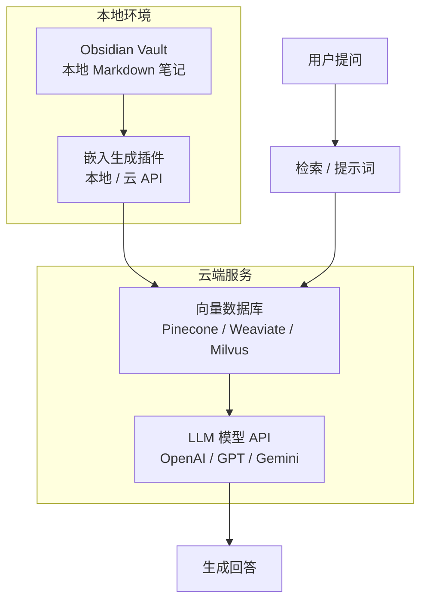

# 执行摘要

Obsidian 是以本地 **Markdown** 文件为基础的个人知识库工具，支持笔记链接、标签、YAML 元数据等特性。对于写作、研究、编程笔记和长期回顾等场景，Obsidian 本身提供了强大的组织和检索功能（全文搜索、标签过滤、Dataview 查询等），并拥有丰富的插件生态（数千种插件可定制工作流）。是否引入 **检索增强生成（RAG）** 技术，取决于用户需求：RAG 可让 LLM 查询外部知识库并提供更准确、及时的回答、减轻幻觉问题、扩展上下文，但也带来隐私、成本和复杂度等挑战。本报告从目标场景、Obsidian 技术栈、集成方案、RAG 优劣、实施步骤、成本估算和不同用户建议等维度进行深入分析，并在末尾给出对比表格和架构示意图（见下文）。

## 目标与场景

Obsidian 适用于多种个人知识管理场景：

- **写作**：撰写文章或创作时，需要检索背景资料、引用笔记或自动生成内容建议；RAG 可辅助生成上下文相关的段落或提炼要点。
- **研究/学术**：整理文献笔记、答疑或撰写报告时，需要访问最新数据或文献。由于 LLM 预训练数据静态，RAG 通过提供实时信息能有效克服过时答案的局限。
- **编程笔记**：记录代码示例、文档摘要等时，RAG 可快速检索先前代码片段或技术说明，但信息敏感度一般较高。
- **个人回顾/长期知识沉淀**：记忆复盘、长期笔记积累场景更依赖内部链接和搜索；需要强语义关联功能时，RAG 及语义搜索插件可以帮助发现遗忘的想法，但对于简单的笔记查询，传统搜索往往已足够。

不同场景对 RAG 的需求不同：科研写作等需要最新信息和智能问答的场景，可以考虑使用 RAG 以增强笔记库的活跃上下文；对隐私要求高或笔记规模较小的普通用户，则可先依赖本地搜索和插件，无需复杂 RAG。

## Obsidian 技术栈

- **核心功能**：Obsidian 将笔记保存在本地文件夹中的纯文本 **Markdown** 文件，支持双向链接、标签、块引用等，实现个人 wiki 效果。笔记可用内置搜索（全文检索）、Graph 视图和 Backlinks 查看关联。
- **格式与元数据**：笔记文件可包含 **YAML Frontmatter**（标题、日期、标签等元数据），可用插件如 Dataview 查询这些结构化元数据。标签（`#tag`）和文件夹也可用于分类管理。
- **插件生态**：Obsidian 拥有开放 API 和数千种社区插件。常用插件包括 Dataview（高级查询），Tasks（日程任务）、Calendar（日历视图）等，这些扩展提升笔记管理和搜索能力。
- **同步与备份**：Obsidian 提供官方 **端到端加密同步** 服务，可跨设备访问笔记；也可使用第三方云存储（如 iCloud、Dropbox）或 Git 同步备份。Obsidian Sync 支持版本历史和团队协作。
- **搜索能力**：内置搜索支持全文检索、正则、排除/包含条件等。配合插件（如 Simple Search、Full Text Search 等）可进一步提升搜索。虽然默认搜索是关键字为主，但配合 Dataview、Tag 管理等，可以实现高级筛选和查询。

整体而言，Obsidian 的技术栈本身强调 **本地、隐私和可扩展性**。RAG 技术的引入需要额外的处理管道和外部依赖，因此需权衡需求与成本。

## 与外部检索/生成系统集成

Obsidian 可通过插件与外部 LLM 服务和向量数据库集成：

- **AI 辅助插件**：例如 **Smart Connections**（本地嵌入语义搜索）和 **Smart Chat**（结合上下文与对话功能），以及第三方插件如 **Text Generator**、**Obsidian AI** 等，可以调用云端模型（如 OpenAI、Anthropic Claude、Midjourney 等）生成文本、回答问题或辅助创作。国内用户也可使用 **AI-zhipu（知谱 AI）** 等插件，调用本地/中文 LLM 服务。
- **向量数据库连接**：插件层面可以将笔记文本分块（Chunking）后生成嵌入向量，再送入向量数据库。在云端可选用 **Pinecone**、**Weaviate**、**Milvus** 等服务，或在本地运行 **FAISS** / **Milvus** 引擎等。以 Pinecone 为例，其全托管向量数据库自动索引，查询延迟可保持低水平；Weaviate 也支持自动生成嵌入、排名和自动扩容；Milvus 开源高性能，可扩展到数十亿向量。
- **嵌入生成**：可以使用 OpenAI 的 `text-embedding-*` 模型生成嵌入（需 API Key 并按调用计费），也可使用开源模型（如 SentenceTransformers、LLaMA-Adapter、Ollama 本地模型等）离线计算。关键指标是检索质量，参考 MTEB 基准评测优秀模型的召回指标。通常将笔记按主题或长度（如每块 1000 token 左右）分块并生成向量，元数据（如笔记标题、日期、标签）可作为检索过滤条件。
- **检索策略**：常用策略包括纯语义检索和混合检索（向量 + 关键字）。例如 Weaviate 的查询示例支持纯向量搜索、纯文本匹配或两者混合。索引更新可以实时增量或定时重建。对于旧笔记，可用 `time decay` 权重降低旧内容相关度。
- **延迟与成本**：调用 OpenAI 嵌入和生成通常有较高延迟（几百毫秒到数秒）和成本（按 token 计费）；向量查询本身延迟极低（亚秒级），成本取决于服务商收费。以 Pinecone 为例，基础免费额度后按查询单元计费，每月几美元可维持低规模库。总体而言，RAG 查询的实时性能瓶颈多在于 LLM API 响应和嵌入生成，不在向量检索。

## RAG 的利弊分析

**技术收益**：

- **增强问答和写作**：通过检索最新、专业的知识库或笔记库内容来提示 LLM，可获得上下文更丰富、领域相关性更高的答案。RAG 提供实时信息以克服 LLM 训练数据截止的缺陷；将检索到的“事实”作为输入提示一部分，可以显著降低生成式 AI 的 **幻觉（hallucination）** 风险。Google 的 RAG 技术说明指出，RAG 通过使 LLM 输出完全基于检索知识，大大提高了生成文本的相关性和正确率。例如在科研写作中，可自动引用文献要点；在编程笔记中，可智能回答历史代码片段。
- **语义检索与上下文扩展**：即使不直接生成新文本，RAG 插件（如 Smart Connections）利用本地嵌入也能提供语义关联笔记，帮助用户发现潜在关联。对于内容积累庞大的仓库，这种关联发现可视作“智能第二大脑”。

**风险与缺点**：

- **幻觉和错误信息**：如果检索源本身内容错误或关联度低，RAG 仍会产生误导答案。LLM 本身易输出错误、过时或不相关信息，RAG 并不能完全消除这一点。检索机制不准确时，会生成无关或错误内容。
- **隐私与安全**：调用云端 LLM 意味着笔记内容需要发送到第三方服务器，存在泄露风险。敏感数据（如企业文档、个人隐私）不宜外传；企业场景需慎用公共云 RAG，或采用自托管方案（本地 LLM 或私有云）。
- **成本**：使用外部 API（如 OpenAI、Anthropic 等）和托管向量库需要付费，成本随使用量增加。大规模索引和频繁查询可能产生较高费用（例如嵌入生成和高级 LLM 输出皆按 token 计费）。此外，插件和维护也增加复杂度。
- **维护复杂度**：RAG 系统需要设计索引更新、缓存、错误处理等机制，比纯文档搜索系统复杂。需要管理 API keys、数据库、安全策略、版本更新等，对普通用户门槛较高。

**替代方案**：

- **本地 LLM**：使用本地运行的开源模型（如 LLaMA2、Mistral 等）可避免数据外泄，但效果和上下文窗口往往受限，且需要强劲硬件。Ollama、AutoGPT 等平台提供本地部署方案。
- **增强搜索**：改进 Obsidian 内置或插件搜索（如 Dataview 查询、全文索引插件）以及使用高质量思维导图或模板笔记来组织知识，也能一定程度上替代 RAG 的需求。
- **模板化笔记**：对常见问题使用结构化模板或 FAQ 笔记，结合快速链接（Linking Your Thinking 等方法），在一定程度上减轻实时问答需求。

## 实施方案与步骤

从零开始建立带 RAG 的 Obsidian 系统，可考虑以下方案：

- **架构选型**：
  - **完全本地方案**：Obsidian 与本地向量库（FAISS / Milvus Standalone）结合，本地生成嵌入和运行 LLM（或轻量化问答器）。此方案数据不出本地，但需自行部署服务并配置硬件。
  - **云混合方案**：Obsidian 依然本地运行，使用 Obsidian Sync 或 Git 同步，向量索引托管在云端服务（Pinecone / Weaviate / Zilliz Cloud 等），LLM 调用云 API（OpenAI / GPT）。这种方案简化管理，但产生费用并需评估数据安全。
- **推荐插件清单**：
  - **Smart Connections**（免费核心），实现本地语义检索和关联。
  - **Smart Chat** 或 **LLM Wiki** 类插件，可在笔记内直接对话或生成内容。
  - **Text Generator** / **Obsidian AI** 等，用于调用 OpenAI / Claude 等生成文本。
  - **Dataview**，用于创建动态查询视图，帮助整合元数据进行检索。
  - **Obsidian Web Clipper**，将外部网页资料快速导入库中，作为 RAG 数据源。
  - 如需多语言或国内 LLM，可用 **AI-zhipu**（调用知谱 AI 模型）或通过 HTTP 请求插件接入自有模型。
- **配置示例**：以云混合为例，流程可为：
  1. 安装 Smart Connections 和 Text Generator 插件。
  2. 在 Text Generator 中配置 OpenAI API Key，并设置所用模型（如 GPT-4、Claude 2 等）。
  3. 在 Smart Connections 设置中选择向量数据库服务（如 Pinecone），配置 API Key；或选“本地嵌入”模式直接使用内置模型。
  4. 定义索引策略：设置笔记分块长度（如 500–1000 token），以及是否索引标题、文件名等元数据。
  5. 运行索引或等待插件自动索引新笔记。确保备份频率与索引一致。
- **数据预处理与分片**：将长笔记按段落或章节分为合适大小的片段，每片生成独立嵌入；在 Metadata（YAML）中保存来源标识和时间戳。对代码笔记可分别索引代码和注释文本。
- **向量索引更新策略**：建议使用增量更新，当笔记新增或修改时自动更新索引；可定期全量重建以防止碎片化。
- **备份与加密**：继续使用 Obsidian Sync 或 Git 对笔记文件备份。敏感时可对本地 Vault 目录进行文件夹加密（例如使用 VeraCrypt 加密容器）。对于向量数据库，云服务一般提供服务端加密功能。
- **权限与隐私控制**：仅在授权设备上安装 Obsidian，并限制外部 API 调用权限。对外部服务开放访问时，需审慎选择可信平台并查看其隐私政策。企业环境下可考虑内部部署向量库或使用企业版安全合规服务。

## 成本、性能与运维估算

- **API 调用成本**：以 OpenAI 为例，嵌入接口（如 `text-embedding-3`）和生成接口（GPT-4 / GPT-3.5）均按 token 计费。嵌入成本极低（百万 token 级别通常几美元），生成成本较高（GPT-4 约数美分/千 token）。示例估算：一次 1000 字检索大约需嵌入几千 token，成本可忽略；一次 GPT-4 问答生成 2000 字大约需要 2 美元。
- **向量数据库费用**：Pinecone、Weaviate 等提供免费试用层，入门几十美元/月可满足小规模需求。性能要求高时，可考虑按需扩容。若使用 Milvus 本地部署，则主要成本为服务器资源。
- **存储费用**：笔记自身仅文本，存储成本极低。向量数据库（云托管）存储费用通常与向量数量相关，一般不高。
- **性能瓶颈**：向量检索速度快（毫秒级），主要瓶颈在于嵌入计算和 LLM 响应时间。推荐批量异步上传嵌入，使用缓存机制减少重复计算。对规模极大的库，可考虑分区检索或上下文预筛选。
- **运维开销**：云方案运维简便，由服务商保证可用性和安全性；本地方案需维护数据库实例、模型环境、更新软件等，需要一定技术投入。总的预算范围：简单使用可低至每月十几美元，较大规模（每天处理上千次查询）可能达到百元/美元级。

## 决策建议

- **轻度笔记用户**：如果笔记主要用于日常记录或学习，且对智能问答需求不高，可先 **不引入 RAG**。利用 Obsidian 本身的搜索、链接和标签功能，或尝试 Smart Connections（本地语义搜索插件）即可，大幅降低成本和复杂度。
- **研究者/学术场景**：若需要频繁从大量文献笔记中提取信息或撰写学术报告，**可以考虑引入 RAG**。利用云端 RAG 能够快速检索和总结最新资料，提高效率。需注意选择信誉服务商并过滤敏感数据。可以先试运行，评估成本后再扩展。
- **专业写作者/创作者**：撰写小说、博客、技术文章等时，RAG 能作为写作助手提供灵感和事实校对，但需警惕生成内容的准确性。可选用混合模式：保留常规笔记习惯，并辅以云 RAG 进行内容校对或草稿生成，成本可控时可适当使用。
- **企业/敏感数据用户**：如果笔记中包含商业机密、患者记录等敏感信息，应 **谨慎采用 RAG**。优先考虑本地化方案：仅在内部网络部署向量数据库和本地 LLM，或使用具有严格安全认证的企业云服务。对这类用户，不引入 RAG 可能是更安全的选择；可以加强内部搜索和知识管理流程作为替代。

总体而言，在评估引入 RAG 时，应平衡 **需求收益与风险成本**：RAG 在增强问答和知识发现方面优势明显，但需要投入相应的技术和费用，并注意隐私保护。建议根据不同用户需求的敏感度和使用频率，灵活决策。

| 方案 | 优点 | 缺点 | 适用用户 | 估计成本区间 |
| --- | --- | --- | --- | --- |
| 传统 Obsidian（本地搜索） | 零成本、高隐私、本地数据全控。无需配置复杂系统，使用简单。 | 只支持关键词检索，无智能生成和扩展上下文能力，查找效率受限于关键词匹配。 | 轻度笔记用户、对隐私要求高者。 | 0（不含付费同步） |
| 云端 RAG 集成（OpenAI + Pinecone 等） | 强大的 AI 问答和写作辅助能力，可利用最新知识库和语义搜索提升输出质量。 | 成本较高（API 调用、托管费用），笔记内容需发送至云端，存在隐私泄露风险，系统复杂度高。 | 研究者、专业写作者（不介意数据外传）。 | 数十～百美元/月（视调用量） |
| 本地 RAG（本地 LLM + FAISS / Milvus） | 数据完全本地化，无外泄风险；一次性硬件投入后无额外 API 费用，可离线使用。 | 需要强大硬件（GPU、内存），本地模型可能精度不及云端大型模型；搭建维护复杂。 | 对数据安全极高要求的专业用户；技术爱好者。 | 硬件成本数千元，软件成本 0 |
| 智能插件（Smart Connections 等） | 使用简便，本地运行，无需 API；可语义关联笔记、辅助发现内容；核心免费。 | 不产生新内容，仅提供智能检索；免费功能较基础，高级功能或 Pro 版需付费。 | 需语义搜索帮助的笔记用户；兴趣探索者。 | 核心免费，Pro 版月费约几十元 |

以上表格概括了不同方案在优缺点、适用场景和大致成本上的差异，供用户根据自身需求做决策。所有建议和数据来源均参考了官方文档、权威文章和插件说明。
