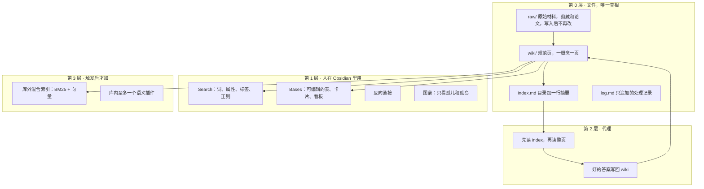
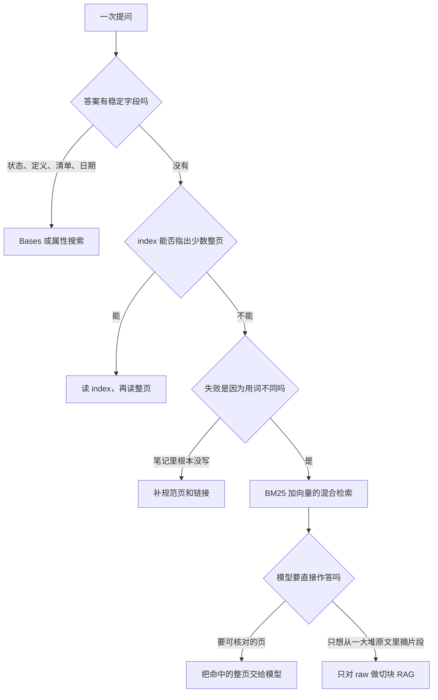

# Obsidian 做个人知识库：技术方案，以及要不要上 RAG

调研日期：2026-10-27。本文只依据公开文档、论文和独立实践记录，不对照任何现有仓库实现。

## 研究概览

问题拆成两段：

1. 用 Obsidian 做个人知识库时，数据、检索、结构和代理访问应该落在哪一层。
2. RAG 该不该成为这套系统的默认路径。

这里的 RAG 指完整链路：把笔记切成块，做成向量，查询时取出若干块，交给模型生成答案。语义搜索、相关笔记推荐、混合检索，都只是这条链路的前半段。把它们都叫 RAG，会把「找笔记」和「让模型作答」混成一件事。

方法是三层检索：先铺官方能力、插件路线和反对意见，再读 Bases、本地向量、混合检索和编译式知识库的原文，最后用 Anthropic、Liu 等人的论文，以及 Obsidian 官方帮助文档交叉核对数字和边界。

## 核心发现

1. **Obsidian 的源数据是本地 Markdown。** 笔记、YAML 属性、双向链接就是知识库。Bases、图谱、搜索、向量索引都是派生物，可以重建，不该变成另一份真相。
2. **人要查的东西，大多数已经能被属性、链接和搜索表达式钉住。** 状态、清单、定义、某个人的会议，走 Bases 或带运算符的搜索。图谱只适合看孤儿和孤岛，回答不了「谁推荐了这个」。
3. **默认不要上生成式 RAG。** 个人知识库的价值在于写下来并保持为当前结论。每次从原始碎片里重新召回，结论不会累积，旧笔记和新笔记还会平权竞争。
4. **向量检索是后加的发现层，而且应当和关键词一起用。** 它解决「换了一种说法就找不到」。人名、论文标题、函数名、日期，仍然要靠词法搜索。单独的向量会漏掉这些。
5. **规模门槛比产品宣传宽。** 大约 20 万 token（Anthropic 在 2024 年的估计，约 500 页）的工作集可以直接放进提示词。Karpathy 在约 100 个来源、数百页 wiki 的规模上，用目录文件导航，没有上嵌入式 RAG。一个 1.6 万文件的库才会把混合检索做成外部索引。个人库先碰到的是笔记没写清楚，不是缺一个向量数据库。

## 建议方案

把知识库做成四层。前两层先建好，后两层等失败模式出现再加。



### 第 0 层：文件布局

一个 vault 就是一个文件夹。Obsidian 官方把数据放在本地 Markdown 里，Bases 的视图可以是 `.base` 文件，也可以嵌在笔记里，数据本身仍在笔记和属性中。

建议目录：

| 路径 | 谁写 | 规则 |
| --- | --- | --- |
| `raw/` | 人，用 Web Clipper 或手动放入 | 原文只读。图片下到本地，避免外链失效 |
| `wiki/` | 人和模型一起维护 | 一页只讲一个概念、人物、决定或来源摘要 |
| `index.md` | 每次入库时更新 | 每页一条：链接、一句话、类型 |
| `log.md` | 只追加 | 固定前缀，例如 `## [2026-10-27] ingest \| 标题`，方便用文本工具回看 |

每篇规范页用 YAML frontmatter，字段尽量少，而且全库同名属性保持同一类型。Obsidian 的属性类型是按名字在全库统一的；同一名字不能在一篇里是文本、在另一篇里是列表。官方支持文本、列表、数字、复选框、日期、日期时间，以及专用的 `tags`。属性里不渲染 Markdown，链接要加引号。嵌套属性官方不支持。

够用的最小字段：

```yaml
---
type: concept
status: current
updated: 2026-10-27
sources:
  - "[[raw/某篇文章]]"
---
```

`type` 用来让 Bases 过滤，`status` 用来表达「这是现在的结论」，`sources` 指回原文。关系写在正文的 `[[链接]]` 里。需要按「包含这个人」过滤时，把人写成列表属性，Bases 可以用 `list(attendees).contains(this)` 这类表达式做嵌入视图。文件夹可以按行动方便来摆，检索键用属性和链接。PARA 一类的文件夹解决的是人把文件放哪，代理问的是跨文件夹的综合问题，文件夹边界帮不上这个忙。

链接默认用维基链接。若这些文件还要被别的 Markdown 工具读，官方允许关掉维基链接，改写标准 Markdown 链接。重命名时官方可以自动更新内部链接。

### 第 1 层：人怎么找

三件工具各管一类问题。

| 工具 | 适合 | 边界 |
| --- | --- | --- |
| 官方 Search | 记得词、路径、标签、属性、日期、正则 | 默认排序是文件名或时间，不是相关度。搜的是笔记和 Canvas 的内容 |
| Bases | 项目板、阅读清单、某人的会议、过期事项 | 从全部文件开始再过滤，没有 SQL 式的 FROM。一行仍是一个文件。重计算和行内字段它覆盖不好 |
| Dataview | Bases 表达不了的计算、行内字段、DataviewJS | 多一层查询语言。视图大多不能当表格直接改。2025 年 9 月的迁移记录里，它的继任 Datacore 仍在开发；本次没有把它在 2026 年的完成度当成事实 |
| 图谱 | 找没有链接的笔记、看有没有断开的簇 | 边没有类型，也不能当查询引擎 |

官方搜索运算符已经覆盖 `file:`、`path:`、`content:`、`tag:`、`line:`、`block:`、`section:`、`task:`，以及 `[status:current]` 这种属性查询。精确问题先写搜索式，不必换一个插件。

相关度排序是官方搜索没做的事。Omnisearch 用 BM25，把词频、文件名和标题算进分数，并支持模糊匹配；它不提供日期和链接过滤。原生搜索和 Omnisearch 是互补的：一个负责结构化约束，一个负责「哪个文件更像这句话」。

图谱的官方能力是过滤、分组、局部图和按创建时间的动画。社区对它的可用上限说得很清楚：能发现孤儿和孤立簇；「只显示某种关系」它做不到。要回答关系问题，把关系写进正文或属性，再用搜索或 Bases。

### 第 2 层：代理怎么读

2026 年 2 月的 Obsidian 1.12 起提供官方 CLI，安装器需要 1.12.7 或更新。官方文档写明：命令行要求应用在运行；若应用没开，第一条命令会把它拉起来。文档另有 Headless 入口，本次没有展开那部分。

CLI 能搜索、读当前文件、列任务和标签、从模板建笔记、在应用里执行 JavaScript。这已经是代理需要的读路径：`search` 得到文件，`read` 读整页。

社区另有把 CLI 包成 MCP 的插件，例如在本机 `127.0.0.1:27124/mcp` 上用 Bearer token 暴露 `search` 和 `execute`。官方帮助文档本身不把 MCP 当作 Obsidian 的功能。能直接读文件夹的代理，也可以不经过 Obsidian 进程，因为真相在文件里。

代理的工作顺序：

1. 读 `index.md`，选出少数页面。
2. 打开这些页的全文，而不是打开切出来的段落。
3. 回答时带上笔记链接。
4. 值得留下的比较、决定和综合，写回 `wiki/`，并改 `index.md` 和 `log.md`。

这一步是 Karpathy 在 2026 年 4 月的 LLM Wiki 备忘里描述的模式：Obsidian 是阅读界面，模型负责维护交叉引用和摘要。他明确写了，在大约 100 个来源、数百页的规模，目录文件就够导航，不必上嵌入式 RAG。同一备忘把 qmd 当作库变大之后的可选搜索工具。这份备忘没有公开基准；2026 年 9 月有人在评论里要评测，可见范围内没有人给出。

### 第 3 层：什么时候加向量

先用自己的失败来触发，而不是先装插件。准备大约 20 个真实问题，分成四类：精确词（人名、标题、命令）、换一种说法、已经过时的旧结论、必须拼多篇笔记才能回答的问题。分别用官方搜索、只读 `index.md`、以及后来的混合检索各跑一遍。混合检索不能在「换一种说法」上明显赢过前两者，就停在第 2 层。

向量要加的时候，加在库外面，当成可重建索引：

- SQLite 里同时放 FTS5（BM25）和向量，用 Reciprocal Rank Fusion 合并名次，而不是把两种原始分数加权。BM25 分数无上界，余弦相似度在一个很小的区间里，直接加权会让词法分数盖过向量。
- 按标题切块，块上带笔记标题和上级标题。块太小会丢掉代词所指；块太大，向量会变成几个主题的平均数。
- 日记、模板、密钥、剪藏附件不进索引。
- 索引目录不与笔记一起同步。Smart Connections 的说明建议在 Syncthing 一类工具里忽略 `.smart-env/`，因为索引可以从笔记重建，同步它只会制造冲突。

Blake Crosley 在 2026 年 3 月公开了他自己的库：16,894 个 Markdown 文件，49,746 个块，一个 83 MB 的 SQLite。全文检索扫一遍要 11–66 秒；混合检索端到端约 23 毫秒。全量重建在 M3 Pro 上约 4 分钟，增量更新不到 10 秒。模型是 Model2Vec 的 `potion-base-8M`，256 维，约 30 MB，无 GPU。他同时写了这个模型在 MTEB 检索子集上只有 31.71，分类是 64.44，选它是为了速度。他也写明：这套系统没有黄金问题集，文中的对比只是一次查询的例子。他观察到的失败包括：标签密集的短笔记压过写得深的长笔记；YAML 和代码块干扰 BM25；切块切断上下文；检索不理解新旧。

库内插件只留一个，避免三套向量各维护一份索引。

| 插件 | 它实际做的事 | 适合放在哪 |
| --- | --- | --- |
| Smart Connections | 本地嵌入，边写边给出语义相近的笔记；核心版默认不需要 API key | 人在写作时发现没链接上的旧笔记 |
| Copilot | Vault QA：词法检索常开，语义检索可选，向量放在 Orama；可用 Ollama 或 LM Studio | 想在 Obsidian 里对话，并且接受再维护一套索引 |
| Khoj | 可自托管的助手，覆盖笔记、PDF 和网页，带自己的服务进程 | 知识源已经超出一个 Markdown vault |
| Text Generator | 按模板往笔记里写 | 生成草稿，不负责检索 |

Smart Connections 作者在 2025 年 9 月仍把量化的 `bge-micro-v2` 当作自己的默认：首次嵌入吃 CPU，之后增量很短，该模型常驻内存不到 100 MB。2023–2024 年有约 1.6 万条笔记时索引膨胀、界面卡住的 issue；那是旧实现的记录，不能当成 2026 年的硬上限，只能说明「在 Obsidian 进程里做全库嵌入」曾经很脆。块级嵌入会把向量数量翻倍，大库应先只嵌整篇笔记。

本地嵌入和云端嵌入的边界，Smart Connections 的说明写得很直接：要给整个库做云端向量，每一篇被索引的文本都要离开本机。本地嵌入把这个顺序倒过来：本机检索，人看过结果，再把少数笔记送进云端对话。本地向量不使云端对话变私密。向量也不是加密，它只是派生物。

### 生成式 RAG 默认关闭

生成式 RAG 只留给 `raw/` 里那些你不打算编成规范页的大语料：一摞论文、长转录、别人的文档。查询结果应带回路径，人打开原文核对。有主键的问题继续走 Bases 和搜索。

判断一次提问走哪条路：



## 为什么个人库不把 RAG 当骨架

几条证据指向同一件事：个人笔记的难点是「哪一条现在算数」，RAG 优化的是「哪一段看起来相似」。

**小语料用检索是多余的机器。** Anthropic 在 2024 年 9 月的 Contextual Retrieval 里写：知识库小于约 20 万 token（约 500 页）时，整份放进提示词即可，配合提示缓存降低费用和延迟；更大之后才需要检索。David Crespo 描述过更小的做法：几十个文件时，先生成大纲，让模型指出相关文件，再把全文放进第二次提示。a-pap 的 Memex 设计把个人记忆定义成小、自己写、按「现在为真」排序，并用一张路由表指向唯一文件，明确不用最近邻。

**长上下文不等于把整个 vault 塞进去。** Liu 等人在 TACL 2024（预印本 2023）的多文档问答实验里，相关文档放在上下文中部时，表现明显下降；文中举例，GPT-3.5-Turbo 在这种摆放下的成绩低于完全不提供文档的闭卷成绩（闭卷为 56.1%）。论文的模型已经旧了，绝对数字不能外推到 2026 年的前沿模型。位置敏感这个现象仍说明：窗口变大之后，把无关笔记整包送入，会把真正有用的那篇埋进中间。

**切块会拆掉笔记赖以成立的上下文。** 块里的「它」「上面的决定」「上一季度」在向量空间里没有所指。Anthropic 的补救是给每块写 50–100 token 的情境句，再同时做嵌入和 BM25。在他们的代码、小说、论文等语料上，只做情境嵌入把 top-20 检索失败率从 5.7% 降到 3.7%；加上情境 BM25 降到 2.9%（相对下降 49%）；再加重排序降到 1.9%（相对下降 67%）。这是企业语料上的检索改进，不是个人笔记该先上 RAG 的证据。它说明：真要做 RAG，朴素切块不够，混合检索才是基线。

**旧结论不会自动让位。** Blake 的失败记录里，14 个月前的架构笔记和昨天的实现笔记可以排得一样高。个人库里这是常态。规范页上的 `status` 和 `updated` 是显式的；向量相似度不是。

**能用主键回答的问题，检索只会添噪。** 一位实践者在 2025 年 5 月把生产系统里不该用 RAG 的情况写成硬规则：要可审计的原文、要聚合和连接、语料小且要精确、要很新的数据、延迟预算紧。他给的量级是「大约一万篇以内、变动少、要精度，用词法搜索加重排序」。这是经验法则，不是测量论文。放到 Obsidian 上，对应关系很具体：过期任务、阅读状态、某人参加的会议，是 Bases 的过滤和公式；「OAuth 和 SSO 是不是在讲同一件事」才是向量的工作。

**每次问答都从零开始，知识库不会变厚。** Karpathy 把 NotebookLM、上传文件、常见 RAG 归成一类：模型每次重新找碎片。编译式 wiki 把综合、矛盾和交叉引用写进 Markdown，下一次提问直接读已经写好的页。维护成本被模型吸收，人负责选材料和判断。这个主张目前没有公开评测支撑，只能当作架构论点，并用上面的 20 题自己验证。

公开检索基准上的另一面也要留着。Karpukhin 等人的 Dense Passage Retrieval 在开放域问答上，top-20 准确率比 BM25 高 9–19 个百分点，因为查询和文档用词常常不同。MS MARCO 上的混合检索也反复优于单一方法。这些语料是网页和问答对，不是一个人持续修改的笔记。个人库同时包含专名和改写，所以混合，而不是用论文结论直接替换掉搜索。

## 观点对照

| 来源 | 主张 | 本次采信的范围 |
| --- | --- | --- |
| Obsidian 帮助文档，2025–2026 | 数据在本地 Markdown 和属性里；Bases 是核心插件；CLI 从 1.12 开始；同步默认端到端加密 | 作为产品事实 |
| got.md 的 Bases 指南，2026 | Bases 负责可编辑视图，Dataview 负责更强的查询，Search 负责临时检索 | 作为分工，不采用文中已损坏的示例 YAML |
| Practical PKM，2025-09-29 | Dataview 自 2021 年起下载量超过 300 万；Bases 已能替换大量日常查询 | 作为社区迁移背景 |
| Smart Connections 文档 | 本地嵌入应是默认；云端嵌入等于把被索引文本送出本机 | 采信隐私边界；不把「相关笔记」当成问答系统 |
| Copilot 讨论，2025-11 | Vault QA 是词法加可选语义，索引可按目录排除 | 采信架构描述 |
| Karpathy，LLM Wiki，2026-04-04 | 先编译成 wiki，中等规模用目录文件，变大再加本地搜索 | 采信架构；不采信未经评测的效果宣称 |
| Blake Crosley，2026-03-01 | 约 1.7 万文件时，库外 SQLite 混合检索比扫描全文实用 | 采信这个规模下的工程数据；他已声明没有黄金集 |
| Anthropic，2024-09-19 | 小于约 20 万 token 不必 RAG；要做 RAG 就用情境化的混合检索 | 采信阈值和失败率；语料不是个人笔记 |
| Liu 等，TACL 2024 | 长上下文中部的相关文档容易被忽略 | 采信现象；不外推具体模型分数 |
| Angirash，2025-05 | 有主键、要聚合、小语料求精度时不要 RAG | 当作决策启发 |

## 同步、历史和隐私

本地库本身不被 Obsidian 加密。多设备同步时，官方 Sync 默认是端到端加密：密钥由 scrypt 从密码派生，数据用 AES-256-GCM。官方写明他们解不开这段数据；密码丢失则远程库无法再加入新设备，也不能代为恢复。标准加密的密钥由 Obsidian 保管，官方明确说它更弱，适合本来就要公开的库。2024 年 9 月有 Cure53 的独立审计报告，细节以 Obsidian 公布的原文为准。

Git 提供笔记历史和分支。远程 Git 主机上的普通 Markdown 是明文。日记、健康和工作笔记若走 Git，需要单独的加密，或接受主机能读内容。向量索引、`.smart-env/`、插件缓存不进版本库：它们能从 Markdown 重建，放进去只会在多设备上冲突。

送进云端模型的内容另算一笔。检索可以全在本机完成；一次云端对话只应带上人点开过的那几篇。

## 趋势

2024 年的默认图画是：切块、嵌入、向量库、生成。Anthropic 同年已经补了一句，小知识库不必走这套，并指出朴素切块会丢掉上下文。

2025 年 Obsidian 把 Bases 放进核心（1.9 起，随后有列表、地图、看板等视图），大量「用查询语言做表格」的需求回到官方功能。本地嵌入插件把「相关笔记」做成不离开本机的侧栏，同时开始暴露本机 MCP。反对把 RAG 当万能层的工程文章也集中出现在这一年。

2026 年的变化是代理直接操作 Markdown。官方 CLI、Karpathy 的编译式 wiki、以及 qmd 这类库外混合引擎（BM25、向量、查询扩展、本地重排序、MCP，项目始于 2025 年 12 月）把 Obsidian 从「聊天窗口的数据源」推回「可版本管理的知识成品」。检索仍在，只是退到工具位置：先有一页写清楚的笔记，找不到时再搜。

## 落地顺序

1. 建 `raw/`、`wiki/`、`index.md`、`log.md`。规范页带 `type`、`status`、`updated`、`sources`。
2. 打开官方 Properties、Search、Backlinks、Bases。用 Bases 做三张视图：进行中的项目、待读、按人聚合的会议或人物页。图谱只用来扫孤儿。
3. 代理从读 `index.md` 开始，用 CLI 或直接读文件打开整页。留下的结论写回 `wiki/`。
4. 攒满 20 个真实问题再决定要不要向量。要加就加库外的 BM25 + 向量，排除日记和密钥，索引不进同步。
5. 库内语义插件最多一个。生成式 RAG 只覆盖不愿编译的 `raw/`。
6. 多设备用官方 Sync 的端到端模式，并自己保存密码。要历史再用 Git，只提交 Markdown。

## 不确定的地方

- 2026 年前沿模型在「上下文中部」上的退化幅度，本文没有新实验，只保留 Liu 等人论文里的现象。
- LLM Wiki「维护成本近于零、所以 wiki 会保持更新」没有公开基准。
- Blake 的 23 毫秒和 4 分钟是一台 M3 Pro、一种静态嵌入模型、没有黄金问题集的个人测量。
- Smart Connections 在上万笔记上的性能，最新的一手说明停在作者 2025 年 9 月的讨论和更早的 issue，不能写成 2026 年 10 月的测量。
- Datacore 是否已经取代 Dataview，本次没有核实到可引用的完成公告。
- qmd 的检索质量没有纳入独立评测，这里只把它当作 Karpathy 点名、且架构符合「混合、本地、可交给代理」的一个现成工具。

## 来源

官方：

- [Introduction to Bases](https://obsidian.md/help/bases)
- [Bases syntax](https://obsidian.md/help/bases/syntax)
- [Properties](https://obsidian.md/help/properties)
- [Internal links](https://obsidian.md/help/links)
- [Search](https://obsidian.md/help/plugins/search)
- [Graph view](https://obsidian.md/help/plugins/graph)
- [Obsidian CLI](https://obsidian.md/help/cli)
- [Obsidian 1.12 更新说明](https://obsidian.md/changelog/2026-02-27-desktop-v1.12.4/)（CLI 随 1.12 发布）
- [Sync 的安全与隐私](https://obsidian.md/help/sync/security)
- [如何验证 Sync 的端到端加密](https://obsidian.md/blog/verify-obsidian-sync-encryption/)

检索与 RAG：

- Anthropic, [Contextual Retrieval](https://www.anthropic.com/engineering/contextual-retrieval), 2024-09-19
- Nelson F. Liu 等, [Lost in the Middle](https://aclanthology.org/2024.tacl-1.9/), TACL 2024
- Karpukhin 等, Dense Passage Retrieval 的表述转引自 Blake Crosley 文中对开放域问答 top-20 提升 9–19 个百分点的引用；个人库不能直接套用该涨幅
- David Crespo, [LLM-only RAG for small corpora](https://crespo.business/posts/llm-only-rag/)
- Angirash, [When RAG Makes Your AI Worse](https://angirash.in/blog/2025/05/08/when-not-to-use-rag/), 2025-05-08
- Umar Salim, [What Is RAG, and Why Can't You Just Give an AI All Your Documents?](https://umarsalim.com/blog/what-is-rag-and-why-cant-you-give-an-ai-all-your-documents/)

Obsidian 实践：

- [Obsidian Bases: The Complete Guide](https://got.md/obsidian-bases/), 2026
- Mike Schmitz, [How to Migrate to Obsidian Bases from Dataview](https://practicalpkm.com/moving-to-obsidian-bases-from-dataview/), 2025-09-29
- Nick Felker, [Obsidian Bases — What are they good for](https://fleker.medium.com/obsidian-bases-what-are-they-good-for-and-what-are-they-not-da620006cb34), 2025-08-27
- [Omnisearch](https://github.com/scambier/obsidian-omnisearch/)
- [Smart Connections](https://smartconnections.app/smart-connections/) 与 [Why local embeddings](https://smartconnections.app/smart-connections/why-local-embeddings/)
- Smart Connections 作者关于默认小模型与本机资源的讨论，2025-09-18：<https://github.com/brianpetro/obsidian-smart-connections/discussions/1211>
- Copilot Vault QA 的混合检索描述，2025-11-09：<https://github.com/logancyang/obsidian-copilot/discussions/2009>
- [Khoj](https://community.obsidian.md/plugins/khoj)
- Blake Crosley, [Building a Hybrid Retriever for 16,894 Obsidian Files](https://blakecrosley.com/blog/hybrid-retriever-obsidian), 2026-03-01
- Andrej Karpathy, [llm-wiki.md](https://gist.github.com/karpathy/442a6bf555914893e9891c11519de94f), 2026-04-04
- [qmd](https://github.com/tobi/qmd)
- a-pap, [memex](https://github.com/a-pap/memex)
- Obsidian 论坛关于图谱能做什么的讨论：<https://forum.obsidian.md/t/q-how-should-i-use-graph-view-correctly-because-im-not-getting-any-ideas/82382>
- [Build a Personal Knowledge Graph](https://self.md/guides/personal-knowledge-graph/)（图谱无类型边、不能查询）
- Dexio, [Obsidian AI: plugins, local models, MCP and agents](https://dexio.wiki/guides/obsidian-ai/), 页面所标更新为 2026-10-01 前后
- [CLI REST / MCP 插件说明](https://dsebastien.github.io/obsidian-cli-rest/mcp-integration.html)
