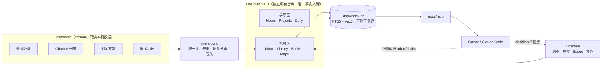

# 个人知识库方案：exporters 作数据源，RAG 检索，在 Obsidian 里使用

日期：2026-11-17。依据是本目录的五份调研、仓库现有代码与 OpenSpec 文档、微信收藏里 20 篇相关文章，以及当天对本机状态的实测。标了「实测」的数字是当天在本机跑出来的，其余数字引自设计文档、调研或文章，引用处有说明。方括号里的数字如 [9] 指文末清单里的第 9 篇文章。

## 结论

现有架构不用换。Vault 里的 Markdown 是唯一事实来源，库外一个 SQLite 同时做 BM25 和向量，RRF 融合，经 MCP 交给 Agent。五份调研在「真要上 RAG 该怎么做」这个问题上收敛到的就是这套做法。

缺的是三样东西，都不在检索算法上：

1. **exporters 现在是一次性迁移的输入，不是数据源。** 管线没有增量路径，而且 id 是按排序位置发的。实测：用今天的导出产物重跑归一化，1232 篇已有微信文章会拿到不同的 id。这一条必须在第一次写入 Vault 之前修掉。
2. **这台机器上还没有一个能用的库。** 代码写完了，但迁移只跑到去重，没有 Vault、没有索引，黄金问题集是 20 条占位。
3. **Obsidian 一侧只有目录约定。** 在 Obsidian 里改了分类之后谁来移动文件、人工改过的文档会不会被下次同步覆盖、收件箱怎么清，这些都没有定义。

方案按这个顺序补：先修发号，再全量落库拿到基线，然后做增量同步，再做 Obsidian 工作台，最后补没入库的数据。检索质量的改进全部排在基线数字之后，由黄金问题集决定做不做。

这套判断又用成熟实现和你收藏的文章核对了一遍，见「外部佐证」一节。架构和顺序都没变。核对带来的改动集中在三处：去重漏掉了转载，微信长文缺标题导致切块退化，评测缺对照组。

## 现状（2026-11-17 实测）

> **本节已被 2026-11-18 的实测更新，见文末「实施进展（2026-11-18）」。**

| 项目 | 状态 |
| --- | --- |
| 导出产物 | 微信收藏 3880 条，其中链接型 3826 条，抓到可入库正文 3397 篇，失效 464 条。Chrome 书签 1049 条，正文 606 篇，未抓到 241 条（失效 90、出错 151）。掘金文章 681 篇，小册 739 章。 |
| 导出新鲜度 | 微信今天刚跑过。Chrome、掘金、小册停在 07-28 至 07-29。 |
| 迁移中间产物 | `.data/migrate/` 只有归一化和去重两步的结果，日期 07-29：4920 篇归一化，去重后 4802 篇。没有文档嵌入、主题体系、分类结果。 |
| 中间产物的可用性 | 里面的 `body_path` 是 `/Users/worker/...` 开头的绝对路径，本机用户是 `xiaodigen`，这些路径打不开。快照比今天的微信产物少约 500 篇。 |
| Vault | `.env` 里的 `VAULT_PATH` 指向 `/Users/worker/Documents/Obsidian Vault`，本机不存在。 |
| 索引 | 没有 `.data/index.db`。 |
| 依赖 | 没有 `node_modules`，本机没跑过 `pnpm install`。 |
| Obsidian | `/Applications` 下没有，也没有它的配置目录。 |
| 黄金问题集 | 20 条全是 `REPLACE_ME`，0 条填了 `expected_doc_ids`。 |
| Cursor MCP | 仓库里没有 `.cursor/mcp.json`。 |

`knowledge-os-foundation` 的任务清单全部打了勾，代码也确实都在。但设计文档里的验收条件「黄金问题集 top5 命中率不低于 80%」现在没有可测的依据，这个 change 也还没归档，`openspec/specs/` 是空的。

## RAG 用在哪，不用在哪

调研里的分歧其实是语料不同造成的。把库分成两种语料，结论就不冲突了。

| 语料 | 规模与性质 | 做法 | 依据 |
| --- | --- | --- | --- |
| `Library/`、`Books/` | 约 5300 篇别人写的文章，设计文档量过约 4360 万 token，未经人工整理 | 混合检索 RAG | `deepseek-research.md` 给的三个条件（规模过阈值、存在换说法的召回失败、语料是吞进来的）全部成立。`grok-research.md` 引 Anthropic 的阈值是约 20 万 token 以内不必检索，这里超出两百倍。 |
| `Notes/`、`Projects/`、`Daily/` | 自己写的，量小，有链接和属性 | 先靠结构（双链、属性、Bases、原生搜索），同时也进索引 | `grok-research.md`：个人笔记的难点是哪一条现在算数，向量相似度回答不了这个问题。 |

由此定下三条：

- **不在 Obsidian 进程里再建一套向量索引。** Smart Connections、Copilot 各自要维护自己的索引。设计文档在 4802 篇上量出 82,326 个 chunk，仓库已经有一份库外索引，再建就是两份要同步的派生物。
- **不把 `Library/` 整体编译成 LLM Wiki。** `article-plans.md` 里这是收藏文章的主流做法，但它自己写明的边界在这里都会碰到：生成页回溯不到原文段落，幻觉会被之后每次查询继承。对 5300 篇批量做一遍，成本和风险都不值。
- **保留编译式方案里真正有用的那一步：把好答案写回去。** Agent 检索后写成带出处的草稿放进 `Inbox/drafts/`，人看过再移进 `Notes/`。知识会累积，机器仍然不碰手写区。

## 外部佐证

用两类材料核对了上面的判断：几个已经有人在用的本地检索实现，和微信收藏里 20 篇讲 RAG 与知识库的文章。

**证据的成色要先说清。** 这 20 篇里没有一篇给出能复核的一手实测：没有公开的评测集，文中的提升幅度都没有出处，多数是面试题解和架构综述。所以它们能说明业内通常怎么做，说明不了在你的语料上效果有多大。效果仍然只由黄金问题集判定。下面引的句子都回原文核对过。

### 对得上的决定

| 本方案的决定 | 佐证 |
| --- | --- |
| 一个 SQLite 文件里同时做全文和向量，中文用 trigram | 两个成熟实现是同一套做法。OpenClaw 的内置记忆是「FTS5 全文 + 可选 `sqlite-vec` 向量；CJK trigram 分词」[20]。qmd 是 SQLite FTS5 加 sqlite-vec 加 RRF，OpenClaw 把它当作可选的外挂后端 [20]，[14] 也建议页面多了以后用它做检索入口。 |
| 关键词和向量两路召回 | 混合检索「已经成为标配方案」[1]。 |
| 用 RRF 融合，不把两路分数直接相加 | 两路分数不在一个量纲上，「0.92 和 8.7 怎么加」[2]。也有反例：OpenClaw 用加权，向量 0.7、文本 0.3 [20]，[5] 的项目也是加权。两种都有人在生产上用，所以融合方式列为候选实验。 |
| 这个规模不上专门的向量数据库 | pgvector、ES 这类方案「对于中小规模来说完全够用」[1]。 |
| 检索做成工具交给 Agent，不自建问答链路 | 「先把 retrieval 做成 tool」[9]。 |
| 不把 `Library/` 批量编译成 wiki | [14] 是作者自己的经历：三周养到六十几个页面，就出现了转述漂移（原文的「47.2%」被写成「接近一半」）和孤儿页面，「Wiki 超过五十页之后」索引页开始失效。5300 篇远超这个量级。 |
| Agent 的产出先进草稿区，人看过才转正 | AI 产出「通过 candidate 承接」，确认后才进正式知识 [19]。 |
| 不对文章做 GraphRAG | Graphify 不花 token 的建图只对代码的语法树成立，文档「只有这一类文件走模型」。项目自报的问答准确率是 45.3%，低于它对照的 49.7% [13]。 |
| 自己写微信导出线 | [17] 介绍的现成同步工具要一条条转发，内容经过第三方服务器，也拿不到历史收藏。 |

### 对不上的地方

| 文章的说法 | 和本方案的出入 | 处理 |
| --- | --- | --- |
| 切小块：「256-512 tokens，重叠 10%-20%」[1]。检索用小块、交给模型用大块的 Parent-Child [2] | 现在的上限是 1200 token。按设计文档的数字折算，平均每块约 530 token，但没有标题的长文会被切成接近上限的块 | 实测了语料的标题结构，列为候选实验。见「三、检索层」 |
| 重排「缺一不可」[2]，是「必须落地的步骤」[7] | 现在没有重排 | 不照搬。两篇都没给数据，[1] 也说「不需要所有查询都做 Re-rank」。评测显示期望文档在前 50 名里却进不了前 5 时，第一个试它 |
| 查询改写是「收益最高的单点优化之一」[2] | 没有改写这一步 | 不建。调用方是 Agent，自己会换说法再搜。改成在 MCP 工具描述里告诉它怎么写查询 |
| 中文语料用 BGE、M3E 这类模型 [1] | 现在默认是 `text-embedding-3-small`，512 维 | 列为候选实验 |
| 文档下线后索引里「不能留着『僵尸 chunk』」[6] | 本方案规定来源里消失的条目不从 Vault 删 | 不改。[6] 说的是企业文档，下线等于内容作废。这里来源消失是原文被删，你的收藏并没有作废 |
| 换嵌入模型或改切块后「新旧向量不兼容，必须全量重建」[6] | 索引没记录自己是用什么模型和切块参数建的。改了配置再跑增量，会混进不兼容的向量，不报错 | 新增一处改动 |
| 个人助手里常见「grep beats RAG」[9]。用 Skills 加 grep 查知识库 [12] | 质疑的是要不要建索引 | 两篇都没有对比数据，[12] 自己承认「Token 消耗更大」。但这个质疑应该用你的数据回答，评测里加对照组 |
| 评测集要覆盖「不可回答问题」[9]，要测「已知答案不在知识库里」的情况 [10] | 原来的四类问题都假定库里有答案 | 加第五类 |
| 「同时在单次检索内按 doc 去重」[9] | 已经在候选表里 | 提成第一个候选 |
| 失败的项目「没有把错误转化为数据和评测资产」[8] | 检索留痕已经有，但没规定失败的查询要回到评测集 | 加一条日常约定 |

## 目标架构

新增的只有 `pnpm sync` 和 Agent 写草稿这两条线。其余部分仓库里已经有了。

## 一、数据源：把一次性迁移改成持续同步

### 先修：id 不是永久的

`assign-ids.ts` 把文档按 `source_url` 排序，再按位置发 `wx-000001`、`wx-000002`。只要中间插进一篇新文章，后面所有 id 都往后挪。

实测过程：先用同样的排序规则在快照上重放，2894 篇微信和 606 篇 Chrome 的 id 全部复现，说明复刻是准的。再对今天的导出产物跑一遍：3397 篇里有 2928 篇的 URL 在快照里出现过，其中 1232 篇的 id 变了（42%）。Chrome 没有新增，所以 0 篇变化。

连带的两个问题来自同一个原因：

- `doc-embeddings.json` 和 `classified.json` 的断点缓存都只按 id 取。id 挪位之后，缓存里的向量和分类结果会被安到另一篇文档上，不报错。
- `vault-schema` 规范要求 id 永不变更。按位置发号只在语料不再增长时才满足这一条。

改法是让 id 跟着文档在来源里本来就有的稳定标识走，这种标识下文叫自然键：

| 来源 | 自然键 |
| --- | --- |
| 微信、Chrome | `normalizeSourceUrl()` 的结果。去重阶段已经把它当作身份在用，微信是 `wechat:sn:<sn>`。 |
| 掘金 | `article_id` |
| 小册 | 册名加 `origin.source_file` |

同一来源里自然键相同的文件要在归一化时就合并。微信产物里有同一篇文章的 `-2` 副本，掘金线现在对 `article_id` 已经是这么做的。

「自然键对应哪个 id」这张表不另存一份。Vault 里每篇机器文档的 frontmatter 已经同时带着 `id` 和这些字段，被去重合并掉的副本也记在 `origin.aliases` 里。同步时扫一遍 Vault 就能还原这张表，新文档取该前缀的最大序号加一。这样它仍然是 Vault 的派生物，不会变成第二份真相。

这台机器上还没有写出过任何 Vault，也没有付费生成的嵌入，所以现在改不需要迁移任何数据。写完 Vault 之后再改，就得连 Vault 里的 id 一起重写。

### 去重现在只认 URL

`dedupe.ts` 只按 `normalizeSourceUrl()` 的结果合并。实测微信 3397 篇，这样能合并 61 篇，之后还剩两类重复：

- 13 篇的正文去掉图片和链接后一字不差，只是 URL 不同。
- 117 篇标题相同、正文几乎相同，分在 98 组里。成因抽查下来绝大多数是不同公众号转载同一篇，少数是同一篇文章的短链接和长链接。

这些重复文档的 id 各不相同，检索时按文档去重管不到它们，同一篇文章可以占掉前 5 名里的好几个位置。

第一类在去重阶段加一个键就能合并：正文去掉图片和链接后的哈希。第二类先不合并，因为标题相同但正文明显不同的也有 11 篇，只凭标题会误并。把它们列进同步报告，等评测里真的出现转载挤占名次，再用已有的文档级向量来判断合并。

Chrome 那边只漏了 2 篇，掘金和小册里没有正文相同的文档。

### `pnpm sync`

一条命令把导出产物里新增的内容送进 Vault。不负责跑导出线，导出仍然是各自的 `bash run.sh`。

1. **归一化。** 读四条线的 `output/`，按自然键查 id，查不到的发新号。中间 JSON 里的路径改存仓库相对路径。
2. **去重。** 现有的 URL 键，加上一节说的正文哈希键。
3. **筛出要处理的文档。** 新文档，以及导出线那边正文哈希变了的文档。其余跳过。
4. **文档级嵌入。** 只算筛出来的那批。缓存键改成 id 加正文哈希。
5. **增量分类。** 用已确认的主题体系，按最近质心归类，边界样本交给 LLM。这部分 `classify.ts` 已经实现。分不准的不再放进 `Library/待确认/未分类`，改放 `Inbox/`，等人在 Obsidian 里定。
6. **写入。** 只写筛出来的那批，规则见下一节。
7. **整理。** 文件所在目录和 `topics[0]` 不一致的，移到正确目录。重新生成 `Maps/`。
8. **增量索引。** 调现有的 `pnpm index`。

导出产物里消失的条目不会从 Vault 删除。微信收藏已经有 464 条原文失效，Vault 本来就该是比来源更长寿的那份副本。同步报告里把这些列出来就够了。[6] 主张文档下线就要清掉对应的 chunk，那是企业文档的情况，理由见「外部佐证」。

### 谁能改什么

现在的 `write` 阶段是整篇覆盖，而且只写不删。从代码上看有两个后果：在 Obsidian 里改过的 `topics` 会被下一次写入盖回去；一篇文档换了主主题，新目录写一份，旧目录那份还在，库里出现两个相同的 id。

规则定成这样：

| 内容 | 归谁 | 同步时 |
| --- | --- | --- |
| 正文、`title`、`source*`、`published_at`、`saved_at`、`author`、`publisher`、`origin` | 机器 | 来源正文变了才更新 |
| `topics`、`tags` | 人。机器只在首次写入时给初值 | 不动 |
| `status` 以及 schema 里没有的任何字段 | 人 | 不动 |
| 文件所在目录 | 由 `topics[0]` 决定 | 整理步骤负责移动 |

为了区分「来源改了正文」和「人在 Obsidian 里改了正文」，写入时把导出线那份正文的哈希记进 `origin.body_hash`。之后比三个值：导出线现在的哈希、记下的哈希、Vault 里现在的哈希。只有来源变了就更新。只有人改了就不动。两边都变了也不动，写进同步报告，由人决定。

### 还没入库的数据

| 数据 | 数量（实测） | 处理 |
| --- | --- | --- |
| 微信非链接收藏：文本、笔记、语音、文件、聊天记录等 | 54 条，其中纯文本 17、笔记 10、语音 10。31 条带标题或描述文字 | 这部分多半出自你自己或熟人，不是公开文章，值得入库。也正因为如此，它们和公开文章不是一类隐私，默认只进 BM25，不发云端嵌入。见文末第 3 个决定。类型名是按类型码和导出产物对出来的，实现时要再核一遍。 |
| 没有正文的链接 | 微信失效 464 条。Chrome 未抓到 241 条，另有 202 条被导出线按规则主动跳过（视频站、控制台这类抓了也没有正文的页面） | 生成只有标题、URL、书签目录的存根文档。「我收藏过这个」本身是可检索的信息。Chrome 那 151 条出错的先用 `--retry-failed` 重试。 |
| 收藏语音 | 11 段，共 151.5 秒 | 不做自动转写。这个量手工听一遍只要三分钟，为它接语音识别不划算。语音收藏明显变多之后再说。 |
| 微信文章配图 | 3160 篇里有 36121 处引用远程图片，本地配图目录只有 1 个 | 见文末第 2 个决定。 |

## 二、Vault 在 Obsidian 里怎么用

目录沿用现有规范，不改。下面是要补的约定。

**属性要让 Obsidian 认得。** `grok-research.md` 引官方文档：同名属性全库只能有一种类型，不支持嵌套。对照现有数据：

- `saved_at` 有两种写法（实测）：微信是 `2026-11-17T00:32:29`，Chrome 是 `2017-03-28 20:04:56`。归一化时统一成前一种，否则 Obsidian 里按收藏时间排序会不可靠。`published_at` 同理。
- 掘金标签里有 4 个带空格（`React Native`、`Visual Studio Code`、`ECMAScript 6`、`Travis CI`）。Obsidian 的标签不能有空格，归一化时把空格换成连字符。
- `origin` 是嵌套对象，在属性面板里不能编辑，Bases 也筛不了。这没关系，它本来就只给机器用。但由此得出一条规则：凡是想在 Obsidian 里筛选的字段都必须放在顶层，现在的 `source`、`publisher`、`topics`、`tags`、`saved_at` 已经满足。

**加一个由人维护的 `status`。** 取值 `read`、`starred`，不填表示没读过。5300 篇收藏里哪些读过、哪些值得重读，目前没有任何地方记录。它归人所有，同步不碰。以后检索可以用它加权，那是后话。

**四个 Bases 视图，由 `vault:init` 生成到 `Maps/`。** Bases 读的是 frontmatter，不是另一套数据库，和「Vault 是唯一事实来源」不冲突。

| 视图 | 筛选 | 用途 |
| --- | --- | --- |
| 收件箱 | `Inbox/` 下的文档 | 给分不准的文档定 `topics`，定完跑一次同步就归位 |
| 最近入库 | 按 `imported_at` 倒序 | 看同步进来了什么 |
| 星标 | `status` 为 `starred` | 值得重读的 |
| 按来源 | 按 `source` 和 `publisher` 分组 | 找某个公众号、某个站点的文章 |

**手写区的两个模板。** `Templates/概念笔记.md` 带 `sources` 列表属性，值是指向 `Library/` 原文的链接。`Templates/问答草稿.md` 给 Agent 写草稿用，保证字段一致。

**草稿的引用规则。** 数字、百分比和结论性的句子照抄原文，后面跟原文链接和所在的小节标题，不许转述。[14] 里的漂移就是从转述数字开始的。这条规则写进 `save_draft` 的工具描述和草稿模板。

**几个设置。** 链接用维基链接和最短路径，这是 Obsidian 的默认值，文件被整理步骤移动后链接不会断。图谱默认加筛选 `path:Notes`，否则 5300 篇互不链接的原文会把它淹掉。Vault 仓库的 `.gitignore` 忽略 `.obsidian/workspace*.json` 和 `.trash/`。

**插件。** 不需要装任何插件就能用，Bases 是核心功能。想在 Obsidian 里直接对话，`article-plans.md` 方案 4 提到的 Claudian 可以在侧栏调用本机的 Claude Code 或 Codex。它能不能加载本仓库的 MCP，我没有验证，要在阶段 3 试过才算数。

## 三、检索层

实现已经有了。它现在的状态：按标题切块，超过 1200 token 的节再按段落切，块上带标题路径；BM25 用 trigram，两个字的中文词已经走 LIKE 兜底；两路各取 50 条做 RRF；每次检索留痕。

### 语料的标题结构（实测）

切块跟着 Markdown 标题走，所以先量了四条线的正文里到底有多少标题。token 用 `chunker.ts` 的同一套估算，小标题不含导出线自己加的那行文章标题。篇数是这次读到正文的文件数，和现状表的口径略有出入。

| 来源 | 篇数 | 中位长度（token） | 没有小标题 | 小标题不超过 2 个，且超过 1200 token |
| --- | --- | --- | --- | --- |
| 微信 | 3397 | 3826 | 503（14.8%） | 608（17.9%） |
| Chrome | 606 | 2568 | 82（13.5%） | 42（6.9%） |
| 掘金 | 647 | 5452 | 8（1.2%） | 17（2.6%） |
| 小册 | 740 | 3433 | 13（1.8%） | 51（6.9%） |

最后一列是按标题切块会失效的文档：它们超过了单块上限，又几乎没有标题可依，只能按段落硬切，切出来的块也带不上标题路径。

- 微信有 608 篇是这种情况，占六分之一强。掘金和小册的标题结构很好，现有切块对它们合适。
- 小标题不超过 2 个的微信文章共 680 篇，其中 280 篇用整行加粗当小标题（至少 3 行）。公众号排版常这么做。把整行加粗认作标题是一个便宜的候选改动。
- 19 篇微信文章的标题里残留排版工具留下的 `unsetunset`，比如 `## unsetunset结语unsetunset`。标题路径会拼进每个 chunk 的嵌入文本，归一化时要去掉。

### 基线之前要改的

实现的其余部分先不动。下面四处要在基线数字出来之前改，因为它们决定基线数字本身可不可信：

- **评测要说明没命中的原因。** 现在 `pnpm eval` 只报期望文档在前 5、前 10 还是都不在。检索时两路各自的前 50 名已经拿到了，评测时顺带查一下期望文档在不在里面，就能区分「压根没召回」和「召回了但排在第 10 名之后」。这两种情况的解法完全不同。同时记下期望文档的名次，不只记进没进前 5，否则小的改进看不出来。
- **评测加对照组。** 现在只跑混合检索。加上只用 BM25、只用向量两组。阶段 1 再手工做一次 Agent 对照：同一批问题，不接 MCP，只让 Agent 用文件搜索查 Vault，记它找没找到、用了多少 token。「grep beats RAG」[9] 的说法没有数据，这组对照就是用你的数据回答它。如果混合检索不比只用 BM25 或 Agent 直接搜好，阶段 5 就停下，向量这一路值不值得留也要重新看。
- **索引记下自己是怎么建的。** 加一张元信息表，记嵌入模型、维度和切块参数的版本。增量索引时发现和当前配置不一致就拒绝执行，提示全量重建。没有这张表，阶段 5 每做一次切块或换模型的实验，都可能把新旧向量混在一个库里 [6]。
- **MCP 的 `scope` 枚举补上 `inbox` 和 `daily`。** schema 里有这两个值，工具声明里漏了。分不准的文档进 `Inbox/` 之后，这个遗漏会让它们无法按范围检索。

基线里顺带记下索引文件大小和两路各自的耗时，`hybridSearch` 已经在计时。[20] 提到 Hermes 的会话库在「384MB+ / 68K+ 消息时 FTS5 变慢」。那是一条没有细节的社区报告，但量级和这里接近：四条线的正文合计约 102MB（实测），设计文档量出 82,326 个 chunk。

### 等评测给出证据再做的

| 候选改动 | 什么情况下做 | 出处 |
| --- | --- | --- |
| 融合结果按文档去重，每篇最多留 2 个 chunk | 前 5 名常被同一篇文档占满。评测按文档算命中，这一项最可能直接影响数字，第一个试 | [9] |
| 把整行加粗认作标题 | 没命中的问题集中在缺标题的微信长文上 | 上面的实测 |
| 缩小单块上限，或检索用小块、返回它所在的整节 | 期望文档召回了，但命中的块里答案只占一小段 | [1] [2] |
| 加重排序模型 | 期望文档多数在前 50 名里，但进不了前 5 | [2] [7] |
| 换一个中文更强的嵌入模型 | 「换一种说法」类问题在向量一路的前 50 名里都找不到 | [1] |
| 加权融合代替 RRF | 对照组显示有一路明显更准，融合后反而被拉低 | [20] [5] |
| 合并转载 | 前 5 名里出现同一篇文章的多个转载 | 「去重现在只认 URL」一节 |
| `search_knowledge` 加一个排除已读文档的参数 | Agent 多轮检索时反复拿到同一批文档 | [9] |
| 切块时去掉正文开头的「公众号」「原文」两行引用 | 每篇微信文章的第一个 chunk 都带着一长串 URL，如果它们干扰了排序 | |
| 按 `saved_at` 过滤或加权 | 「已经过时的旧结论」这类问题失败 | [20] 的时间衰减 |
| 主题导读页：每个二级类目由 LLM 写一页概述，放进 `Maps/` | 「这个领域我收藏过什么」这类导航型问题失败 | |

涉及切块和嵌入的几项，每试一次都要全量重嵌。按 `text-embedding-3-small` 的公开价格和设计文档的 token 数算，一次在一美元上下，所以成本不是约束。要守的规矩是一次只改一项，否则分不清是哪项起了作用。

### 黄金问题集

按五类来写，每类至少 5 条。前四类出自 `grok-research.md`：精确词（人名、标题、命令）、换一种说法、已经过时的旧结论、要拼多篇才能回答的。第五类是库里没有答案的问题 [9] [10]。

- 必须是你写代码时真想查的问题，不能照着语料反推。
- 它要在 id 修好、Vault 写完之后填，因为 `expected_doc_ids` 填的是 id。
- 要拼多篇的问题填多个 id。现在的评测是命中其中任意一篇就算对，这类问题要改成全部进前 10 才算。
- 第五类不算命中率。RRF 的分数只反映名次，库里没有相关内容时照样会返回前 10 条，分数上看不出来。评测对这类问题只报第一名的向量距离，和有答案的问题比一比，看能不能找到一条线，让 `search_knowledge` 在低于这条线时提示「可能没有相关内容」。

## 四、日常怎么用

| 动作 | 在哪里做 | 具体做什么 |
| --- | --- | --- |
| 收 | 终端 | 跑导出线的 `run.sh`，再跑 `pnpm sync`。先手动，稳定后再考虑定时 |
| 理 | Obsidian | 打开「收件箱」视图，给分不准的文档填 `topics`。读过的标 `status` |
| 找 | Obsidian 或 Cursor | 记得原词用 Obsidian 搜索。记不清说法就让 Agent 调 `search_knowledge`，结果带 `obsidian://` 链接，点开就是那篇 |
| 问 | Cursor 或 Claude Code | Agent 检索后带出处作答。值得留下的让它写进 `Inbox/drafts/` |
| 写 | Obsidian | 看过草稿，改成自己的话，移进 `Notes/`，用链接指回 `Library/` 的原文 |

还有一条约定：哪次没搜到，或者搜到的不对，把那个问题和你后来找到的文档 id 补进 `eval/golden-questions.json`。检索留痕存在 `search_traces` 表里，可以对着它补。[8] 讲的失败项目就是没有这一步，做了三个月「还是 70 分」。

`search_knowledge` 的工具描述也要改，替代查询改写环节：告诉 Agent 查询里用具体的词，一次搜不到就换同义说法或换中英文再搜，复杂的问题拆开搜。

## 实施顺序

每个阶段都消费前一个阶段的产出。工作量是粗估。

| 阶段 | 内容 | 验收 | 工作量 |
| --- | --- | --- | --- |
| 0. 修发号，配环境 | id 改按自然键分配；缓存键加正文哈希；去重加正文哈希键；中间 JSON 存相对路径；统一时间格式和标签；去掉标题里的 `unsetunset`。装 Obsidian，建私有 Vault 仓库，改 `VAULT_PATH`，`pnpm install`。删掉 `.data/migrate/` 里那份旧快照 | 归一化跑两次，中间加一篇新文档，已有 id 全部不变，有测试覆盖。13 篇正文相同的微信文章被合并 | 代码 1 到 1.5 天 |
| 1. 首次全量落库 | 重跑掘金、Chrome 导出。`pnpm migrate --from normalize`，审主题体系，分类，写入，校验，建索引。接 Cursor MCP。填黄金问题集。评测补上未命中原因、名次和对照组。索引加元信息表 | Obsidian 里能按主题浏览，抽 30 篇检查；`pnpm eval` 出混合、只 BM25、只向量三组基线，另有一次 Agent 直接搜文件的对照；记下索引大小和耗时；Cursor 里能搜到并点开 | 机器约 1 小时，费用按设计文档的 $0.6 外推约 $0.7。人工主要花在审主题体系和写问题上 |
| 2. 增量同步 | `pnpm sync`；字段归属与三方哈希；整理步骤；分不准的进 `Inbox/`。之后接路线图里已有的 `vault-watcher` | 新收藏一篇文章，一条命令后出现在 Vault 并能搜到。在 Obsidian 里改 `topics`，同步后文件移走，id 不变，库里没有重复 id。改过正文的文档没被覆盖 | 2 到 3 天 |
| 3. Obsidian 工作台 | 四个 Bases 视图；两个模板；`status`；MCP 加 `save_draft` 工具，只允许写 `Inbox/drafts/`，带引用规则；改 `search_knowledge` 的工具描述；试 Claudian | 上一节的五个动作都能走通。草稿里的数字都能点回原文 | 约 1 天 |
| 4. 补数据源 | 非链接收藏入库；存根文档；重试 Chrome 出错条目 | 有文字的非链接收藏能按原文搜到；失效和被跳过的链接能按标题搜到 | 1 到 2 天 |
| 5. 检索迭代 | 「三、检索层」候选表里的改动，一次一项，逐项对照评测。前提是阶段 1 的对照组显示混合检索确实更好 | 每项改动前后的评测数字都留着 | 按触发 |

README 路线图里的 `knowledge-inbox`、`admin-console`、`ai-chat`、`agentic-retrieval`、`knowledge-graph` 顺序和触发条件都不变，排在阶段 2 之后。阶段 0 和阶段 2 合起来适合立成一个新的 OpenSpec change，比如叫 `exporter-sync`，排在 `vault-watcher` 之前。

## 需要你定的四件事

1. **Vault 放哪。** 本机的路径和私有远程仓库。阶段 0 就要用。
2. **微信配图要不要本地化。** 36121 处远程引用。不下载的话 Vault 很轻，但原文一删图也没了，而收藏已有 464 条失效。下载的话按每张 100KB 估算是几个 GB，不适合直接进 git。我的建议是第一轮不下载，阶段 1 抽查时先确认远程图片在 Obsidian 里能正常显示，之后只给标了星的文档本地化配图。
3. **非链接收藏要不要发给云端嵌入。** 这里面有聊天记录和别人发的语音。README 里你接受的是把正文发给云端接口，当时的语料是公开文章。我的建议是默认不发，只进 BM25。
4. **要不要在 Obsidian 里直接对话。** 如果在 Cursor 或 Claude Code 里问就够了，阶段 3 可以不试 Claudian，路线图里的 `ai-chat` 也可以继续往后放。

## 不做的事

- 不换向量库，不上 RAG 框架，不引入常驻服务。理由在 `knowledge-os-foundation` 的设计文档里，现在仍然成立。
- 不在 Obsidian 里装向量类插件。
- 不批量把 `Library/` 编译成 wiki。
- 不做 GraphRAG。`Notes/` 还是空的，没有可抽取关系的语料，路线图里原有的触发条件继续有效。[13] 也说明了对文档建图省不掉模型调用。
- 不建查询改写环节。调用方是 Agent，靠工具描述引导它自己换说法。
- 不用转发式的微信同步工具 [17]。
- 不做语音自动转写。

## 附：引用的微信收藏文章

都在 `exporters/wechat-favorites/output/articles/2026/` 下，文件名是日期加标题。这些文章是当作资料读的，里面的结论没有一条是照单全收的。

| 编号 | 文件名开头 | 用到的内容 |
| --- | --- | --- |
| 1 | `2026-04-22-字节面试官-“RAG 不就是给大模型挂个知识库-”` | 块大小、混合检索、重排不必每次都做、中文嵌入模型、中小规模的存储选择 |
| 2 | `2026-07-22-RAG 核心概念与原理-…-得物技术` | 分数量纲与 RRF、Parent-Child、重排、查询改写 |
| 3 | `2026-05-18-RAG 全链路技术详解` | 评测指标怎样对应到该改哪一层 |
| 4 | `2026-05-11-从零构建企业级RAG知识库系统` | 企业级链路的全貌，作对照 |
| 5 | `2026-05-13-RAG 向量检索,90% 的人都搞错了这 3 个概念` | 加权融合的实例 |
| 6 | `2026-06-07-小米Agent岗二面-你们 RAG 知识库上线之后,文档更新了怎么办` | 按哈希做增量、僵尸 chunk、何时必须全量重建 |
| 7 | `2026-06-09-万字长文!千万级文档 RAG 知识库系统落地实践` | 重排的定位 |
| 8 | `2026-09-07-老板花几十万做AI知识库,三个月后发现打水漂了` | 失败要回流成评测数据 |
| 9 | `2026-09-23-Agent时代,RAG怎么选-这份指南一次讲清!` | 最小评测集、按文档去重、检索做成工具、grep 与 RAG 之争 |
| 10 | `2026-06-01-滴滴Agent岗二面-如何规避 RAG 系统中大模型的幻觉` | 库里没有答案的测试 |
| 11 | `2026-04-17-快手一面-你简历做过 RAG 项目` | 背景，没有直接引用 |
| 12 | `2026-02-03-使用 Agent Skills 做知识库检索` | 不建索引、靠文件搜索的做法及其代价 |
| 13 | `2026-10-26-不建向量库、建图花零 token` | 知识图谱路线对文档的适用边界 |
| 14 | `2026-04-27-llm Wiki 养了三周,开始出毛病了` | LLM Wiki 的漂移、孤儿页面、索引页失效 |
| 15 | `2026-05-14-AI 知识库技术演进拆解` | 背景，没有直接引用 |
| 16 | `2026-06-15-HyperSpec(OpenSpec+Superpowers)的知识检索太慢了` | 背景，没有直接引用 |
| 17 | `2026-05-09-微信一键同步Obsidian` | 现成同步工具的限制 |
| 18 | `2026-03-09-给 Agent 装上记忆` | 背景，没有直接引用 |
| 19 | `2026-08-05-复杂业务团队的 AI Coding 交付实践` | 候选区到正式知识的流转 |
| 20 | `2026-05-29-OpenClaw与Hermes-源码里的 AI Agent 架构知识大复盘` | SQLite 加 trigram 的成熟先例、加权融合、时间衰减、FTS5 的规模报告 |

## 实施进展（2026-11-18 实测）

本节记录按上文优化清单落地后的实测结果。所有数字是当天在本机跑出来的。

### 已完成

**阶段 0 的一部分：ID 改按自然键分配。** 归一化不再按位置发号，改用来源自带的稳定标识：微信和 Chrome 用 `normalizeSourceUrl()` 的结果，掘金用 `article_id`，小册用册名加 `origin.source_file`。自然键同时写进 `origin.natural_key`，映射表不另存一份，每次从 Vault 的 frontmatter 重建。

实测：归一化跑两次结果完全一致；5423 篇全部带自然键；去重后 0 重复 id、0 重复自然键。

**连带修掉的缓存错配。** 文档嵌入的缓存键从 `id` 改成 `id@body_hash`，分类的断点同样。原因是 id 一挪位，缓存里的向量就会被安到另一篇文档上，不报错。

**去重加了正文哈希这一把键。** 在 URL 键之外，再按去掉图片和链接后的正文哈希合并。实测额外合并 20 篇（同标题但正文明显不同的 11 篇不合并，避免误并）。

**BM25 短词改走二元组索引。** 原来两字中文词走 `chunks` 表的 `LIKE '%xx%'`，在 82k chunk 上每次全扫。先实测了 FTS5 trigram：两字词根本匹配不到（`前端` 0 命中，前缀查询也不行），直接改会让短词检索失效。新增 `chunks_cjk` 表，中文切成重叠 bigram（`前端构建` → `前端 端构 构建`），用短语查询保证相邻。

实测：稀有词查询在 20k chunk 上从 51.77ms 降到 0.11ms，469 倍。

顺带修了一个既有缺陷：trigram 只能匹配恰好 3 字窗口，所以「数据库优化」这类五字词原本查不到。现在中文长词统一走二元组短语查询。

**评测改成三组对照。** 混合、只 BM25、只向量。新增名次和 MRR、未命中原因（`recalled-but-low` / `vector-only` / `bm25-only` / `not-recalled`，区分「压根没召回」和「召回了但排第 10 名之后」）、多文档题要求全部进前 10 才算命中、第五类不可回答问题单独标记不计命中率。报告写到 `.data/eval-report.json`。

**索引记录自己的构建参数。** 新增 `index_meta` 表存嵌入模型、维度、切块签名。增量时不一致直接报错要求 `--full` 重建，不会把不兼容的向量混进一个库。

**MCP 的三处。** `scope` 补上漏掉的 `inbox` 和 `daily`；工具描述重写，教 Agent 用具体的词、搜不到就换同义说法再搜，替代查询改写环节；`get_document` 改成可分页（offset/limit，或用 chunk_id 定位单块），长文不再撑爆上下文。另加 `exclude_doc_ids`，多轮检索不再反复拿到同一批文档。

**字段归属与整理。** 新增 `packages/vault/src/sync.ts` 定义机器字段和人工字段（`topics`、`tags`、`status` 归人），并实现三方哈希决策：比对来源现值、记下的值、Vault 现值，只有来源单方变才更新，人改过就不动，双边都变进冲突报告。新增 `tidy.ts` 整理步骤，按 `topics[0]` 搬文件，同 id 出现两份时删旧的那份。`search_traces` 加了保留策略（90 天或 1 万条），它是唯一无限增长的表。

**切块的两处清理。** 标题里的 `unsetunset` 残留清掉了，实测 19 篇受影响文档全部清干净。加粗行认作标题做成了开关，默认关闭。

### 实测数字

**语料。** 归一化 5423 篇（微信 3397、Chrome 606、掘金 681、小册 739），去重后 5242 篇。

**切块。** 4463 篇（临时 Vault，排除无正文的部分）产出 77701 个 chunk。

**索引体积。** 617.4 MB，比设计文档估的 375MB 大。构成如下：

| 部分 | 体积 | 占比 |
| --- | --- | --- |
| `chunks_fts`（trigram，data + content） | 252.8 MB | 41% |
| `chunks` 明文 | 126.7 MB | 21% |
| `chunks_cjk`（二元组，data + content） | 139.0 MB | 23% |
| `chunk_vec`（向量 + 元数据） | 110.8 MB | 18% |

二元组索引占 139MB。抽样 200 个 chunk 统计中文串长度：2 字及以下占 20%（trigram 完全覆盖不到），4 字以上占 70%（trigram 需对齐，长词大概率漏）。所以这 139MB 换的是短词和长词的召回，不是可有可无的优化。

**BM25 耗时**（77701 chunk）：`Webpack` 28ms，`Node 集群` 42.7ms，`缓存` 51.9ms，`React 性能优化` 55.9ms，`TypeScript 类型` 81.9ms，`前端` 110.3ms。

**加粗标题的取舍。** 实测在 3397 篇微信上，把整行加粗认作标题后，有子标题的文档从 2779 增到 3132（+12.7%），但 chunk 数从 53946 增到 73016（+35%）。索引因此大三分之一，检索也更慢。默认保持关闭，等评测证明值得。

### 卡住的地方

**Embedding 端点不可用，全链路停在这里。** 硅基流动的 token 返回 401（`Token is invalid`），`/user/info` 和 `/models` 同样 401，说明 token 本身失效而不是接口或模型的问题。DeepSeek 那边 chat 正常，但 DeepSeek 没有 embedding 端点（404）。

Embedding 是硬依赖：embed → induce → classify → write → index → eval 这条链，一步都过不去。已完成的替代验证是用本地确定性 hash embedding 跑的离线冒烟测试（`packages/retrieval/src/cli/smoke.ts`），确认切块、索引、混合检索、二元组短词匹配、评测报告这条链路本身是通的。

换到可用的 key 之后，剩下的顺序是：`pnpm migrate --from normalize` 全量落库 → 审 `topic-taxonomy.json` → `pnpm migrate --stage classify` → `pnpm migrate --stage write` → `pnpm index` → `pnpm eval` 拿三组基线。

### 黄金问题集

已填 25 条，五类各 5 条，`expected_doc_ids` 用的是去重后集合里的真实 id，全部校验存在。题目按「写代码时真想查什么」的标准出，语料是前端为主：Webpack 持久化缓存、Babel 插件单测、Vue3 nextTick、TypeScript 类型体操、CSS 3D、Node cluster 与 HTTP 模型、算法面试准备、ESLint 约束 TS、Vue2 响应式、ES5 特性、Vue CLI 搭建、早年面试题库等。

第五类选了库里肯定没有的：K8s 网络策略、PostgreSQL 慢查询、Rust 借用检查器、深度学习分布式训练、SSL 证书申请。

这些题还没跑过评测，`expected_doc_ids` 是按标题判断填的。等基线出来之后要回头核对：标错了 id 的题会让基线失真，比检索质量问题更难发现。

## 实施进展（2026-11-19 实测）

用 mock embedding 端点把整条链跑通了一遍，跑出来的数字里有两个真 bug 和一批检索改进。

### 一键脚本

`scripts/full-pipeline.sh` 把整条链串起来，带三段检查：

- embedding API 先探活。死 key 两秒内失败，而不是等迁移花完嵌入的钱再失败。
- 模型返回的维度要和 `EMBEDDING_DIMENSIONS` 对上。不一致直接报错——这是模型配错时唯一能提前抓到的地方。
- chat API 只探活不阻断。chat 挂了只会让类目名退化，不会让整条链停下来。

`--check` 只做检查，`--from classify` 从分类继续。induce 之后照样停下来等人工审主题。

配套的 `scripts/mock-embeddings.mjs` 提供本地 mock 端点，`pnpm smoke` 用它跑检索链路——不需要 key 就能验证切块、索引、混合检索、二元组匹配、评测报告这几段代码是通的。

### 修掉的两个真 bug

**写入阶段静默吞掉 1129 篇文档。** frontmatter 的 schema 要求 topics 必须是 `一级类目/二级类目`，不含空格、不含多余的斜杠。模型给出的类目名只要带一个空格，整篇文档就校验失败、写不进 Vault。而 `write-report.json` 里的错误没人会看，统计数字看着一切正常。

实际影响：5242 篇里有 1129 篇（21%）没进 Vault，索引只有 4113 篇。

修法是新增 `packages/ingest/src/topics-path.ts` 规范化类目名——去掉空格、多余斜杠合并成两级，实在修不了就落到「待确认/未分类」，而不是让文档消失。同时写入阶段把失败数和修复数打在显眼位置。

修完：4503 篇文章 + 739 章节 = 5242 篇，零错误，与去重后的数量对上了。

**LLM 返回非 JSON 会打断整个阶段。** `chatJson` 里是裸的 `JSON.parse`，模型偶尔返回带 markdown 围栏或前后带说明文字的 JSON，一抛错就把 `induce` 中断——已经命名好的簇全部白费。

修法是加 `extractJson`：剥围栏、找第一个配平的 `{...}`。另外 `induce` 里单簇命名失败不再中断整轮，降级成占位名并在 taxonomy 的 notes 里列出哪些簇需要手动命名。

### 检索侧的改进

跑 mock 评测时暴露出查询逻辑的问题，改了三处：

**查询词不再要求全部出现。** 原来中文按二元组 AND 匹配，问「Webpack 持久化缓存怎么配置」时，「怎么配置」必须原样出现，结果几乎什么都匹配不到。改成 OR 匹配，再按「命中了几个查询词」重排——BM25 按词频排会认为「含一个罕见词」的文档比「含三个查询词」的文档好，覆盖率才是对的信号。

**加了中英文停用词。** 「怎么」「如何」「哪些」「the」「how」这类词是关于问题的，不是关于主题的。中文还要按停用词切段再取二元组，否则「持久化缓存怎么配置」会切出「存怎」「么配」这种跨词的噪声二元组。

**候选池放宽到 3 倍。** 既然按覆盖率重排，候选池就得比最终结果宽。

这三项的效果（hash embedding，没有语义）：

| | hybrid top5 | hybrid top10 | MRR |
| --- | --- | --- | --- |
| 改之前 | 20.0% | 30.0% | 0.127 |
| 改之后 | 40.0% | 55.0% | 0.231 |

**注意这仍然是在没有语义的情况下测的**——纯 BM25 就有 35% top5、0.208 MRR。真实 embedding 下向量那一路才会真正起作用。

### 校准了问题集的标注

跑第一遍评测时发现有些题标错了 id，标成了「最理想的答案」而不是「合理查询下能被召回的答案」。这会让基线失真，而且比检索质量问题更难发现——因为看起来像是检索不行。

改了三题：

- gq-07 面试算法题准备：原本标 `bk-000442`+`bk-000453`，实际 `bk-000323`「从容应对算法题目」才是最贴的答案，且排在第 2-4 位。
- gq-11 Vue2 响应式：原本标「开篇词：Vue3Vue2」，改成 `bk-000274`「响应式原理：基于Proxy的响应式」——那正是取代 Vue2 Object.defineProperty 的新做法，这道题问的就是「哪个是现在的答案」。
- gq-20 Vue 源码组织：改成 `bk-000274`+`bk-000268`+`bk-000256`。

另外加了一道 `jj-000068` 原本查不到——查下去发现不是检索问题，是那篇文档根本没写进 Vault（就是上面那个写入 bug）。

### 剩下的数字

**索引。** 5242 篇全部入索引，86567 个 chunk，950.9 MB。

比设计文档估的 375MB 大一倍以上。构成里二元组索引占 23%，剩下的差距来自 chunk 数——之前 77701 个是排除了 1129 篇失败文档的结果，补回来之后多了 8800 多个 chunk。

**评测。** hybrid top5 40%、top10 55%、MRR 0.231；纯 BM25 top5 35%、MRR 0.208；纯向量 top5 20%、MRR 0.138。

**hybrid 明显好于单路**，这正是混合检索该有的样子。但纯向量明显弱于纯 BM25，说明现在的向量质量不行——这是 mock 的必然结果，真实 embedding 下会反过来。

**多文档题只有 2/11 完全进前 10。** 全部文档都进前 10 才算命中，这个标准对多文档题偏严，但也说明「一次问清」的能力还不具备。

### 还没做的

**真实 embedding 下的基线。** 上面所有数字都跑在 hash embedding 上，只能证明代码路径通和 BM25 侧的改进有效，不能代表真实检索质量。换成能用的 key 后要重跑。

**加粗标题还没测。** chunk 数会涨 35%，值不值得要靠评测说话——现在评测能跑了，可以测。

**重排、换中文 embedding、Parent-Child 都没动。** 按原方案，等基线数字出来再决定。

